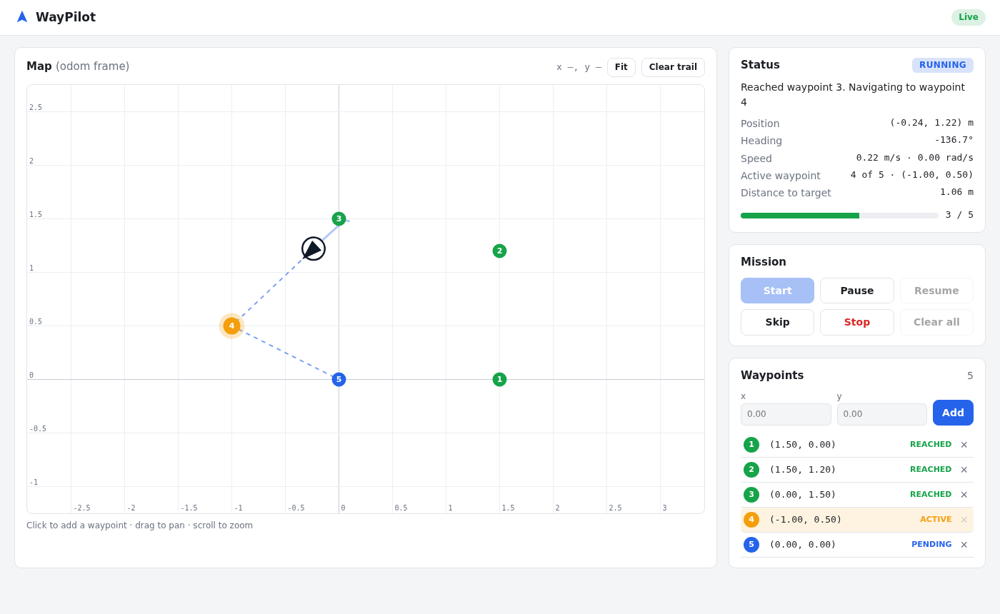
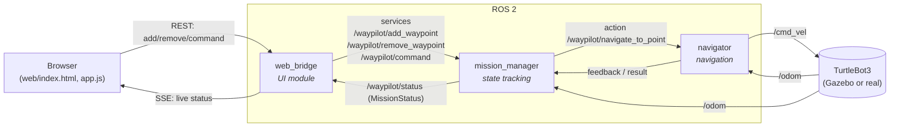
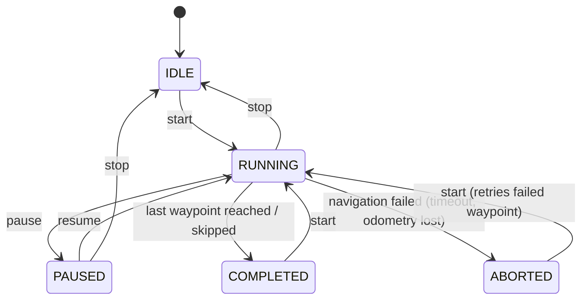

# WayPilot: Waypoint Follower with a Web UI

WayPilot drives a TurtleBot through a list of 2D waypoints that you manage in a browser. You add points by clicking a live map or by typing coordinates. You start, pause, skip or stop the mission. The page shows the robot's position, the active waypoint and progress in real time.



---

## Architecture

The system has three ROS 2 nodes, and each one has a single responsibility.



| Node | Module | Responsibility |
|---|---|---|
| `web_bridge` | UI | Serves the single-page UI. Turns HTTP requests into service calls and streams `/waypilot/status` to the browser over Server-Sent Events. It holds **no** mission state. |
| `mission_manager` | State tracking | Owns the waypoint list and the mission state machine. It sends the navigator one goal at a time and moves on when a waypoint is reached. It publishes a full `MissionStatus` snapshot at 5 Hz. |
| `navigator` | Navigation | An action server that drives to **one** point. It runs a 20 Hz control loop from `/odom` to `/cmd_vel` and knows nothing about missions. |

### Why this split?

- **Actions for motion and services for edits.** Driving to a point is a long-running task that needs feedback and cancellation, which is what an action provides. Editing waypoints and issuing commands are quick request/response calls, so they are services.
- **One source of truth.** Only `mission_manager` changes mission state. The UI renders whatever the last status message says, so several open browser tabs always agree.
- **The core logic has no ROS dependency.** `controller.py` (control law) and `mission.py` (state machine) are plain Python, so they are unit tested without a ROS graph, including a closed-loop simulation of the robot's motion.
- **No extra web dependencies.** The HTTP server uses the Python standard library, so the only requirement is a standard ROS 2 install. There is no rosbridge, Flask or Node.

### Custom interfaces (`waypilot_interfaces`)

| Type | Name | Purpose |
|---|---|---|
| msg | `Waypoint` | `id`, `x`, `y`, `status` (PENDING / ACTIVE / REACHED / SKIPPED) |
| msg | `MissionStatus` | State, message, waypoints, active index, progress, robot pose and speed, distance to target |
| srv | `AddWaypoint` | `x, y` → `success, message, id` |
| srv | `RemoveWaypoint` | `id` → `success, message` |
| srv | `MissionCommand` | `start` / `pause` / `resume` / `stop` / `skip` / `clear` |
| action | `NavigateToPoint` | Goal `x, y` · feedback `distance_remaining, heading_error` · result `success, message, final_distance` |

---

## Mission state machine



Rules:

- **Adding** waypoints works in every state. Points added while running are appended to the route. Points added after completion run next time you press **Continue**.
- **Removing** works in every state, except for the *active* waypoint while running or paused. Skip it or stop the mission first.
- **Clear** is only allowed when the mission isn't running or paused.
- **Stop** puts the active waypoint back to pending. **Start** then continues from the first waypoint not yet visited. When every waypoint has been visited, **Start** reruns the whole route.
- **Skip** marks the active waypoint as skipped and moves on. It also works while paused.
- Results from goals that were cancelled or replaced are ignored. Each goal dispatch carries a token, and callbacks with an old token are dropped, so a late result can never advance the wrong waypoint.

## Navigation control law

`controller.py` implements a "turn, then drive" point controller for a differential-drive robot:

1. Compute the distance and heading error to the target.
2. If the distance is **≤ `goal_tolerance`** (default 8 cm), the waypoint is **reached**.
3. If the heading error is **> `rotate_in_place_threshold`**, rotate in place.
4. Otherwise drive at `v = clamp(k_linear·d, min_linear_speed, max_linear_speed) · cos(heading_error)` and steer at `ω = clamp(k_angular·heading_error, ±max_angular_speed)`.
5. A **hysteresis** band keeps the robot from switching rapidly between rotating and driving. It starts driving only once the heading error drops below `drive_threshold`.

Safety measures in `navigator`:

- It publishes a zero velocity on success, cancel, preemption, abort and shutdown.
- If odometry is older than `odom_timeout`, it stops the robot. If odometry stays missing for `odom_lost_abort` seconds, it aborts the goal.
- Each waypoint gets a time budget that grows with its distance: `goal_timeout_base + goal_timeout_factor × distance / max_linear_speed`. A far waypoint is never cut short by a fixed limit.
- Only one goal is tracked at a time. A new goal preempts the old one.
- On Ctrl-C or launch shutdown, the node sends a final zero-velocity command before it exits, so the robot never keeps the last command it received.
- In `mission_manager`, a goal cancelled by another ROS client, or a navigator that goes offline mid-goal, moves the mission to ABORTED instead of leaving it stuck in RUNNING.

---

## Requirements

- Ubuntu 22.04 with **ROS 2 Humble**
- `colcon`
- For the simulation: `ros-humble-turtlebot3-gazebo` and `ros-humble-gazebo-ros-pkgs`

```bash
sudo apt install ros-humble-turtlebot3-gazebo ros-humble-gazebo-ros-pkgs
```

No pip packages are needed.

## Build

```bash
cd ~/WayPilot                         # the workspace root (this repository)
source /opt/ros/humble/setup.bash
colcon build --symlink-install
source install/setup.bash
```

## Run

### Simulation (TurtleBot3 + Gazebo + all WayPilot nodes)

```bash
ros2 launch waypilot waypilot_sim.launch.py
# options: model:=burger|waffle|waffle_pi  gui:=true|false  port:=8080
```

Then open **http://localhost:8080**.

### Real robot (or any robot that already publishes `/odom` and accepts `/cmd_vel`)

Bring up the robot first, for example `ros2 launch turtlebot3_bringup robot.launch.py`. Then start the three nodes:

```bash
ros2 launch waypilot waypilot.launch.py
# options: port:=8080  use_sim_time:=false  params_file:=/path/to/params.yaml
```

### Using the UI

1. **Add waypoints.** Click on the map (snaps to 5 cm), or type x/y into the form. Coordinates are in the `odom` frame, in metres.
2. Press **Start**. The robot visits the waypoints in list order.
3. Watch the **Status** card: state, position, heading, speed, active waypoint, distance to target and progress. The map shows the robot, its trail, and the remaining route as a dashed line.
4. **Pause / Resume / Skip / Stop** at any time. **Clear all** removes every waypoint once the mission is stopped.
5. Drag to pan and scroll to zoom. **Fit** brings back automatic framing.

The connection badge in the top-right shows **Live**, **No data from robot** (the bridge is up but no status is arriving), or **Disconnected** (the browser reconnects automatically).

---

## HTTP API

The browser uses this API, and it works from `curl` too:

| Method | Path | Body | Description |
|---|---|---|---|
| `GET` | `/api/status` | – | Latest mission status (JSON) |
| `GET` | `/api/events` | – | Server-Sent Events stream of status updates (about 5 Hz) |
| `POST` | `/api/waypoints` | `{"x": 1.0, "y": 0.5}` | Add a waypoint |
| `DELETE` | `/api/waypoints/<id>` | – | Remove a waypoint |
| `POST` | `/api/mission/<cmd>` | – | `start`, `pause`, `resume`, `stop`, `skip`, `clear` |

Write requests (`POST` and `DELETE`) must send `Content-Type: application/json`.

Responses have the form `{"success": bool, "message": str, ...}`. Status codes: `200` OK · `400` invalid input · `403` cross-origin request · `404` unknown route or command · `409` rejected by the state machine (for example, pausing when not running) · `415` request not sent as JSON · `503` mission manager offline · `504` service timeout.

```bash
J='Content-Type: application/json'
curl -X POST -H "$J" localhost:8080/api/waypoints -d '{"x": 1.0, "y": 0.0}'
curl -X POST -H "$J" localhost:8080/api/waypoints -d '{"x": 1.0, "y": 1.0}'
curl -X POST -H "$J" localhost:8080/api/mission/start
curl localhost:8080/api/status
```

## ROS interface (without the UI)

```bash
ros2 service call /waypilot/add_waypoint waypilot_interfaces/srv/AddWaypoint "{x: 1.0, y: 0.0}"
ros2 service call /waypilot/command waypilot_interfaces/srv/MissionCommand "{command: start}"
ros2 topic echo /waypilot/status
```

## Parameters

All parameters live in [`src/waypilot/config/waypilot.yaml`](src/waypilot/config/waypilot.yaml).

| Node | Parameter | Default | Meaning |
|---|---|---|---|
| navigator | `max_linear_speed` | 0.22 m/s | Top forward speed (TurtleBot3 Burger limit) |
| | `min_linear_speed` | 0.03 m/s | Speed floor, so the robot doesn't stall just short of a waypoint |
| | `max_angular_speed` | 1.5 rad/s | Top turn rate |
| | `k_linear`, `k_angular` | 0.8, 2.0 | Proportional gains |
| | `goal_tolerance` | 0.08 m | Radius within which a waypoint counts as reached |
| | `rotate_in_place_threshold` / `drive_threshold` | 0.6 / 0.25 rad | Heading-error hysteresis band |
| | `control_rate` | 20 Hz | Control loop rate |
| | `odom_timeout` / `odom_lost_abort` | 0.5 s / 5 s | Stop the robot / abort the goal when odometry is missing |
| | `goal_timeout_base` / `goal_timeout_factor` | 30 s / 3.0 | Time budget per waypoint = base + factor × distance / max speed (base ≤ 0 disables it) |
| mission_manager | `status_rate` | 5 Hz | Status publish rate |
| | `max_coordinate` | 50 m | Rejects waypoints outside ±this value |
| | `max_waypoints` | 200 | Maximum waypoints in the list |
| web_bridge | `host`, `port` | 0.0.0.0, 8080 | HTTP address the server listens on |
| | `service_timeout` | 3 s | Time limit for each service call |

## Tests

```bash
colcon test --packages-select waypilot && colcon test-result --verbose
```

- `test_controller.py`: angle maths, rotate/drive decisions, hysteresis, speed limits, and a **closed-loop simulation** that drives a modelled robot around a 5-point route and checks that every waypoint is reached within tolerance.
- `test_mission.py`: every state transition, invalid commands, stale-result handling, skip/stop/restart behaviour, and the rules for adding and removing waypoints.
- `test_api.py`: request validation, the cross-site request checks, and status serialisation.
- `flake8` and `pep257` style checks.

The full stack has also been run in Gazebo with a 4-point route that includes a waypoint behind the robot. All points were reached with a final error of at most 8 cm. Pause, resume, skip, stop and clear were also checked through the HTTP API.

## Project layout

```
WayPilot/
├── README.md
└── src/
    ├── waypilot_interfaces/        # msg / srv / action definitions (ament_cmake)
    └── waypilot/                   # nodes, web UI, launch files (ament_python)
        ├── waypilot/
        │   ├── controller.py           # control law (no ROS)
        │   ├── mission.py              # mission state machine (no ROS)
        │   ├── api.py                  # HTTP validation / serialisation (no ROS)
        │   ├── navigator_node.py       # navigation node (action server)
        │   ├── mission_manager_node.py # state-tracking node
        │   └── web_bridge_node.py      # UI node (HTTP + SSE)
        ├── web/                    # index.html, app.js, style.css
        ├── launch/                 # waypilot.launch.py, waypilot_sim.launch.py
        ├── config/waypilot.yaml
        └── test/
```

## Limitations and possible extensions

- Waypoints are followed in a straight line from one to the next, with **no obstacle avoidance**. The design leaves room for this: `navigator` could be swapped for an adapter around Nav2's `NavigateToPose` action without touching the other two nodes.
- Waypoints are kept in memory. Saving and loading routes as JSON would be a small addition to `mission_manager`.
- The web server has no authentication. Run it only on a trusted network. Write requests from other websites are blocked: the server checks `Origin` and requires a JSON content type.

## License

MIT, see [LICENSE](LICENSE).
